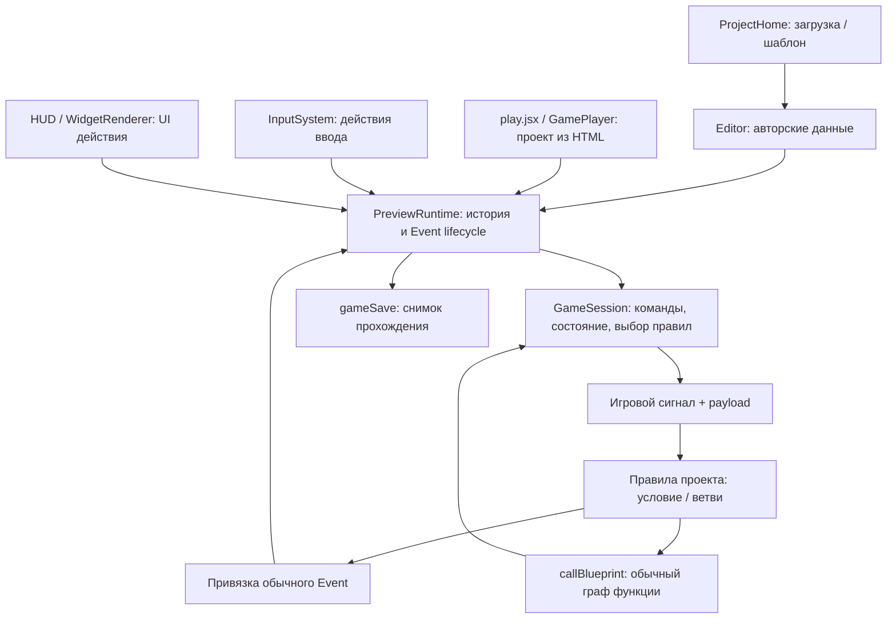

# Аудит и переход к общей системе механик

Дата: 13 октября 2026 года. Ветка: `feature/new-ui-fix`.
Область: текущая рабочая копия `engine-web-prototype/frontend`, включая уже
существующие незакоммиченные изменения. Это не аудит чистого состояния ветки.
На этапе исходного аудита добавлены только этот документ и characterization-тесты;
пользовательская логика, шаблоны и внешний вид не меняются.

## Продуктовый контракт и границы

Приоритет имеют [обязательные требования](../../../docs/PRODUCT-REQUIREMENTS.md),
[проверка каждого изменения](../../../docs/CHANGE-CHECKLIST.md) и
[приёмка «Дверь с ключом»](../../../docs/ACCEPTANCE-DOOR-WITH-KEY.md).
Новеллы, point & click и их сочетания остаются основным продуктовым сценарием.

Путь автора: выбрать объект/сцену/проект → добавить готовую механику → настроить
несколько понятных параметров → запустить. «Когда / Если / Сделать / Иначе»,
Event, функция и граф раскрывают те же определения, а не запускают альтернативные
реализации. Обычная настройка и перенос не требуют JSON, кода, ID или путей свойств.
Сложная логика остаётся редактируемой в штатном редакторе.

Сохраняем JS/React/Three.js, `project.objects`, существующие Events, Action Groups,
функции, ввод, виджеты, переменные, сохранения и экспорт. Не вводим новый движок,
ECS, язык, идентичности объектов или конкурирующий планировщик. Движение, физика
и рендер остаются обычными низкоуровневыми системами. Пакеты содержат данные,
не устанавливают код. Магазин, платежи, новые аккаунты и облачный обмен не входят
в миграцию; существующая авторизация проекта не становится условием локального обмена.

## Проверенные точки входа

| Путь | Реальное поведение и связь с механиками |
|---|---|
| `main.jsx:5,10 → AuthGate.jsx → ProjectHome.jsx → Editor.jsx` | `AuthGate` использует локальный режим либо существующую авторизацию серверного хранения. `ProjectHome` загружает проект через `readProject`, открывает `Editor`, читает встроенные шаблоны и файлы. |
| `ProjectHome.jsx:59 → builtinTemplates.js → projectFromTemplate` | Встроенные шаблоны — реальные JSON в `public/game-templates`. Создаётся копия проекта, затем применяется обычный upgrade. Это не отдельный игровой runtime. |
| `Editor.jsx:372–375 → PreviewRuntime` | Редактор держит один runtime в ref, направляет в него предпросмотр, ввод, HUD и события. Изменения проекта и автосохранение принадлежат редактору, а исполнение — runtime. |
| `play.jsx → GamePlayer.jsx → PreviewRuntime` | Standalone читает вложенный проект через тот же `readProject`; использует тот же GameSession, LocationScene, HUD, виджеты и ввод. Нет зависимости от AuthGate или Editor. |
| `gameExport.js → scripts/build-player.mjs` | Экспорт HTML вкладывает проект, ресурсы, CSS и сборку `play.jsx`. `build:player` собирает её отдельно; `npm run build` сначала вызывает этот же скрипт через `prebuild`. |

Проверка графа локальных импортов: `main.jsx` достигает 142 JS/JSX-модулей,
`play.jsx` — 60, `runtime.js` — 27. `App.jsx` и `Studio.jsx` в этих графах
не достижимы; `StudioParts.jsx` — другой, активно используемый модуль.
В графе зависимостей `runtime.js` нет импортов React. Старые App/Studio не являются
точками входа этого редактора и не должны определять план. Удалять их в аудите нельзя.

Связь с рендером проходит через `physicsApi.current` (colliders/raycast/planMotion),
который дают Scene/LocationScene. GameSession имеет обычный JS fallback на
gamePhysics и authored objects. Это граница адаптера, а не импорт компонента
редактора в runtime; headless тесты не проверяют все отличия fallback от Three.js
сцены. В обоих entry используется один и тот же адаптер рендера.

Игровой сигнал (`pickup`, `hit` и т. п.) — уведомление с payload. Event —
редактируемое определение с группами действий, размещением, ожиданием и временем
жизни. Сигнал выбирает правила; правило может вызвать функцию или привязку Event.
Нельзя объединить эти сущности одним переименованием.

## Владельцы данных и потребители

Все пути ниже относительны `frontend/src`. Номера строк — ориентиры текущей
рабочей копии; имя функции является устойчивой точкой поиска.

| Данные / ответственность | Где определены и кто записывает | Кто читает и исполняет |
|---|---|---|
| Объекты, сцены, история | `project.objects`, `subscenes`, `chapters[].beats`; `studioModel.js:44 upgradeProject`, `projectFiles.js:7 readProject` | `PreviewRuntime.enter`, `sceneFor`, `sceneEditing`, Scene/LocationScene, StoryFlow, пакетный сборщик. ID объекта остаётся ID из `project.objects`. |
| Нативные возможности | `gameplayModel.js:11 defaultGameplay`: `playerId/controller/camera/actors/weapons/items/recipes/rules/inventory`; `mechanicsModel.js` устанавливает/адаптирует их | `GameSession.config` ссылается на gameplay копии проекта runtime; камера, HUD, валидаторы и обмен читают те же данные. `mechanics[]` — авторские привязки, не вторая база объектов. |
| Каталог механик | `mechanicsModel.js:5 registerMechanic`, `:10 mechanicsFor`, `:23 addMechanic`; существующие настройки показываются через адаптеры `native:*` | `GameplayWorkspace.jsx`, `MechanicFields.jsx`, пакетный экспорт. Простые Event-механики создают обычные Event/функцию/правило; нативные устанавливают существующие поля. |
| Events / Action Groups | `project.events[].groups[].actions`; `authoringModel.js` также содержит библиотеки действий и групп и создаёт редактируемые копии | `studioModel.bindingActions/batchesFor`, `runtime.binding/action`, EventEditor, предпросмотр, HUD, функция и игровое правило. `sourceTemplateId` хранит происхождение, не отдельного исполнителя. |
| Размещение Event | `beat.bindings`, фазовые batches; `newBinding`, `normalizeBatches` в `studioModel.js:23–26` | `runtime.phase/binding`; `GameSession.trigger` создаёт временную привязку того же формата. Overrides не меняют исходное определение Event. |
| Выбор реакций | `gameplay.rules`: сигнал, сцена/объект, условие, then/else Event/функция/переход | `GameSession.js:22 trigger` фильтрует правила; условие вычисляет `evaluateExpression` либо `callFunction`. Очередь на rule ID последовательная, разные правила независимы. |
| Функции / графы | `project.functions`: параметры, locals, entry, nodes, связи и координаты; `BlueprintFunctionWorkspace` редактирует этот JSON | `blueprintFunctions.js:23 callBlueprint`; команды проходят обратно через `GameSession.command`, Event-нода — через `runEvent → runtime.binding`. Лимиты: 1000 шагов и глубина вызова 16. JS из графа не исполняется. |
| Прохождение истории | `PreviewRuntime.snapshot`: beat/phase/ready, history, interacted, choiceResults, variables | `enter/advance/chooseNext`, ввод, диалог/выбор, сохранение. `start` клонирует проект и начальные переменные; runtime не мутирует авторский оригинал. |
| Состояние механик | `snapshot.world.game`; `GameSession.initialize/tick/command`: actors, weapons, inventory/equipment, timers, rules, bodies, projectiles, tracers, clock | Камера, GameHUD/WidgetRenderer, команды, сохранение. Авторские `maxHP`, magazine, starting inventory не являются текущими HP/боезапасом/инвентарём. |
| Незавершённое исполнение | `snapshot.instances/states/effects`; runtime generation/runId; `GameSession.flights/queues/pendingTransition/destination/route/pendingPickup` | Native Event lifecycle, отмена, переходы, подбор, движение. Это не сериализуемое продолжение графа; save сейчас не сохраняет эти очереди и Promise. |
| Ввод | `inputModel.js`, `project.input.actions/contexts`; `InputSystem.js:13` | `GameControls` подаёт устройства; InputSystem разрешает приоритеты/consume и фазы действия, runtime.inputAction выбирает поведение и обычный Event. Контексты механик добавляются в существующую систему. |
| Виджеты / HUD | `project.widgets`, `project.ui`, `gameplay.hudWidgetId`; `widgetModel`, `widgetBindings` | `GameHUD` выбирает HUD и прицел; WidgetRenderer читает variables/game и отправляет Event/команду в runtime.uiAction. Виджет не выполняет боевую логику. |
| Хранение проекта | `ProjectHome`, `Editor`, `projectLifecycle`, `accountStorage/serverStorage` | Editor автосохраняет авторский проект. Standalone использует свою среду хранения; сохранение прохождения `sacura-save:${project.id}` не заменяет сохранение проекта. |
| Обмен авторской логикой | `mechanicPackages.js`, `PackageExchange.jsx`, `Editor.changeAssetLibrary` | Сбор зависимостей → preview/привязки → validate/plan → атомарная замена клона. Технические ID создаёт редактор; импорт не регистрирует исполняемые расширения. |

### Контракты исполнения, которые нельзя случайно изменить

* `runtime.js:116 start` останавливает прежний запуск, меняет generation,
  клонирует проект, создаёт GameSession и входит в историю. Диалог shooter-intro
  предшествует бою; старые проекты активируют механику в gameplay-ноде,
  новые допускают continuous рядом с диалогом. В ENDING механика не тикает.
* `phase:321` исполняет batches по порядку; batch PARALLEL ждёт Promise.all,
  SEQUENTIAL — каждую привязку. `binding:331` исполняет группы Event последовательно,
  действия внутри группы — параллельно. Это нельзя заменить последовательным
  списком команд под названием «механика».
* `binding:398`: NONE и STARTED сейчас возвращаются без ожидания всей работы;
  FLOW_END ждёт завершения работы; EVENT_END после ожидания отвергает удерживаемый
  Event. AUTO_CLOSE_ON_FLOW_END и HOLD_UNTIL_STOPPED сохраняют разную семантику.
  Не вводим дополнительные Promise-очереди поверх этих правил.
* `delay/assert`, generation и runId прекращают отменённые действия; остановка
  отдельного Event не должна останавливать остальные. Переход сцены снимает
  эффекты владельца SubScene, сохраняя соответствующие Scene/GameSession эффекты.
  Вызов функции проверяет тот же generation после await.
  `stop` очищает instances/effects/control и ставит EDIT, но оставляет world.game
  для снимка редактора; этот остаток не означает работающий игровой запуск.
* `GameSession.command('goTo')` ставит pendingTransition; переход выполняют
  `flushTransition` и native `host.enter`. Прямой переход из нового обработчика
  может обойти завершение Event, очистку сцены, историю и выбор ввода.
* `InputSystem.resolve` сначала выбирает контексты по priority, затем consume
  отсекает нижние каналы. Смена контекста отменяет действие и блокирует уже
  удерживаемую кнопку до отпускания. Миграция не должна давать «протекание» клика
  диалога в выстрел/подбор или повторно запускать input Event.
* `GameSession.tick` ограничивает dt до 0.05, обновляет низкоуровневую физику,
  AI, снаряды, перезарядку и таймеры. Pause замораживает игровое время.
  Эти циклы не превращаются в async Events на каждый кадр.

## Конкретные жанровые связи и риск изменений

Важно отделять остаточные ограничения от уже снятых. Текущая рабочая копия
содержит каталог, пакетный обмен и независимые цели; возвращать прежние
ограничения ради последующего снятия не требуется.

| Ограничение и место использования | Потребители и последствия | Минимальное изменение и риск |
|---|---|---|
| **Обязательный герой в старом authoring**, `gameplayAuthoring.prepareGameplayScene:4`, `applyGamePreset:17–28`: создают персонажа, playerId, HP=100 и жанровый набор ввода. | Старые helper-тесты `gameplay-authoring.test.js`, JSON шаблонов и тестовые fixtures. GameplayWorkspace только реэкспортирует helper, текущий каталог его не вызывает. Нельзя считать тест с названием «browser authoring buttons» проверкой нынешней UI-кнопки: он вызывает helper напрямую. | Сохранить legacy adapter для старых данных/тестов до перевода. В `defaultGameplay/validateGameplay` нет обязательного playerId/HP/genre; не добавлять такую обязательность в core. Риск: старт, коллизия героя, input context и entry истории меняются одновременно при замене helper. |
| **Один контролируемый объект**, `GameSession.enter:18`, `setDestination/step:56–64`, `runtime.playerInteract:690`, defaults target в `command:55`. | GameControls, story gate, point-click, jump, области без явного объекта. Без героя direct pickup работает, однако ближайший предмет через playerInteract всё ещё рассчитывается относительно playerId. | Для обычной механики использовать явные object/target параметры; playerId оставить совместимым адаптером управления. Проверить click/direct/input пути отдельно, не заменять ID объекта новыми actor ID. |
| **HP и смерть связаны с управляемым объектом**, `damage/heal:43–44`, `useItem:51`. | Смерть playerId снимает playerControl, смерть остальных скрывает объект; useItem запрещён при смерти героя и лечит его. HUD и healing function читают global hp. | Health выполняет урон/сигналы; реакции видимости, прекращения управления и лечения конкретной цели задаёт использующая возможность/заготовка. Сохранить старое поведение адаптером до перевода шаблона. Риск: смерть нейтрального объекта, смена управления, расход аптечки и порядок hit/death. |
| **Глобальные ammo/reserve/kills/hp**, `GameSession.initialize:17`, `sync:19`, `applyGamePreset:22`. | Боезапас уже хранится по weapon ID, но один weaponId выбран глобально; sync перезаписывает существующие одноимённые globals. Kill counter привязан к team=enemy. Shooter HUD, use-medkit/damage-feedback/award-kill и сохранения зависят от алиасов. Quest тоже получает неиспользуемые HP/ammo globals. | Сначала явно описать мост совместимости, перевести каждую функцию/виджет и тест. Затем убрать автоматическую синхронизацию из общего слоя. Риск: затереть авторскую переменную ammo, HUD разных владельцев показывает одно оружие, изменение сохранённых variables. |
| **Победа внутри урона**, `GameSession.damage:43`: после смерти не-player сканирует ВСЕ enemy actors проекта и выдаёт victory. | Правило shooter-victory выбирает shooter-win; `addGameplayVictory` создаёт такой consumer; StoryFlow показывает nextBeatId. Не только объекты текущей сцены входят в проверку. | Перенести цель «все выбранные противники побеждены» в обычное правило/функцию шаблона на сигналах здоровья. Legacy victory оставить до перевода всех потребителей. Риск: враги другой сцены блокируют победу, повторное уведомление, уход в ending до score/function; нужен тест порядка последнего убийства. |
| **AI с целью-героем по умолчанию**, `tick:67`, `addGameplayEnemy:12`, JSON shooter actors. | Сейчас работает `ai.targetId || playerId`; явный targetId уже доступен в pursuit. Старый helper/шаблон targetId не задают. Actor.nextAttack и HP входят в общий actors state. | В данных шаблона явно задать цель и отдельно health/attack/pursuit. Сохранить fallback для старых файлов. Риск: AI перестаёт двигаться/атаковать после смены героя, упирается в отсутствующую позицию, меняется line-of-sight. |
| **Камера/прицел от preset только при адаптации**, `legacyCamera:12`, `ensureGameplay:13`, `applyGamePreset:18`. | `cameraModel.resolveCamera:30`, GameControls.pointerLock, Scene/LocationScene скрытие first-person цели, GameHUD.crosshair уже используют camera.mode/targetId/flags. Но eyeHeight/distance/fov/sensitivity лежат в controller; shoot:45 использует общий yaw/pitch/eyeHeight и ownerId fallback playerId. | Не переписывать runtime по preset: он уже разделён. Адаптировать shared camera/controller параметры и ownership выстрела после тестов импортов camera/weapon. Риск: камера на другом объекте стреляет из прежнего героя; меняется старый FPS HTML/сохранение. |
| **Частично закрытые команды/триггеры**, `gameplayModel:4–10`, `GameSession.command:55`, `runtime.inputAction:642`, `inputModel.INPUT_BEHAVIORS:5`. | RegisterGameCommand/RegisterGameSignal уже расширяют labels и executor, но поля GameplayCommandFields — цепочка известных команд, input behaviors валидируются закрытым списком. Регистрация signal не создаёт источник уведомлений автоматически. Пакет объявляет command/action capabilities, не отдельные версии signal. | Расширить существующее определение команды параметрами, типами ссылок, валидацией и editor metadata; использовать его в форме, пакете и dispatcher. Input Event остаётся универсальным путём. Не считать добавление label полной поддержкой возможности. Риск: команда исполняется, но не настраивается/не переносит refs; сигнал импортируется без источника. |
| **Несогласованные граф/выражения/история**, `BlueprintFunctionWorkspace:11–13`, `blueprintFunctions:19,49`, `mechanicPackages:13–14`, `GameplayCommandFields:17`. | В графе дублируются nodeKinds/ops. UI не предлагает min/max/lte/gte, поддерживаемые runtime; get picker показывает верхние globals, а шаблон использует вложенный results.defeated. GoTo UI предлагает dialogue/gameplay/end, runtime допускает также gate/choice/branch/set-variable/merge. | Один существующий descriptor для доступных native операций и назначения переходов; сохранить сериализацию и штатный executor. Риск: открытие/изменение скачанной функции меняет её выражение или недоступен её переход. Расширенный редактор не должен быть единственным способом изменить обычное условие. |
| **Закрытые базовые типы действий**, `model.js:5 TYPES`, `makeAction:27`, `runtime.action`, `projectFiles:16`. | TYPE задаёт domain/completion для диагностики и authoring defaults; runtime исполняет известные типы. Неизвестный TYPE не загрузится, даже если trusted game command зарегистрирован. Native gameplay action служит существующим входом команд. | Новые команды прежде всего подключать через gameplay action и существующий registry; новый базовый TYPE добавлять только при иной семантике lifecycle и согласованной поддержке loader/validator/editor/package/runtime. Риск: регистрация только одного списка даёт невоспроизводимый экспорт или меняет ожидание действий. |

Дополнительные статические риски, **не воспроизведённые отдельными тестами этого
аудита**: `trigger:25` ставит once.fired до проверки условия; `storyFlowModel`
показывает nextBeatId только для gameplay-ноды, не continuous реакцию диалога и
не elseNextBeatId; `widgetModel` создаёт стандартный HUD с HP/ammo даже для
нейтрального проекта; `restoreGameSave` не сбрасывает все временные поля маршрута,
pendingTransition/queues. Это кандидаты для следующего обследования, не заявления
о падающей исходной тестовой базе.

## Реальные шаблоны и проверяемые зависимости

Прочитаны оба JSON, а не только `builtinTemplates` и helper. Числа ниже относятся
к исходным JSON; upgrade дополнительно создаёт стандартные библиотечные Events.

| Шаблон | Авторские данные | Существенное текущее поведение |
|---|---|---|
| `shooter.sacura-template.json` | 1 сцена, 30 объектов, 6 actors (герой 100 HP, 5 врагов), 2 оружия, 3 item definitions, 5 rules, 5 Events, 4 функции, 6 widgets. `preset=fps`, без новых camera/activation/mechanics. | upgrade даёт firstPerson/героя и gameplay-node. Intro → combat; death-player → Event shooter-death → Game Over; death-enemy → award-kill; victory → win. Пистолет: 25 damage, 8/40; launcher: 100 damage, 3/6. Аптечка лечит 40, одна есть при старте. HUD использует globals и вызывает equip/heal Events. |
| `point-and-click.sacura-template.json` | 2 сцены, 11 объектов, 4 Events, 1 функция, 8 widgets. Контроллер point-click, герой с HP, хотя квесту здоровье не нужно. | Предметы ключ/записка, рецепт prepared-key, Event quest-open-door меняет vars и дверь, затем goTo в другую сцену. Pickup вызывает quest-log; получение relic ведёт в win. Журнал — массив, quest HUD — инвентарь. |

В shooter `award-kill` сравнивает objectId с **литералом** `shooter-hero`;
это скрытая внешняя ссылка. `use-medkit` и `damage-feedback` зависят от hp/medkits,
award-kill — от score/results.defeated. Уход от globals нельзя делать удалением
полей из gameplayModel: нужно сначала перевести эти графы, виджеты и их saves.
Quest-door связывает объект, переменные и destination beat — хороший минимальный
пример отдельного переносимого Event без копирования исходного мира.

## Форматы и перенос до новых абстракций

| Формат / путь | Что переносит | Ограничение и решение |
|---|---|---|
| Проект v1/v2, `projectFiles.readProject`, `upgradeProject` | Полные авторские данные; gameplay имеет собственную version=1 | readProject проверяет shape/ID, input/widgets и часть gameplay/functions, но возвращённые validateStudio issues не запрещают загрузку. Редактор может открыть проект с диагностикой; пакетный импорт не должен перенять эту слабую гарантию. |
| `sacura-project-template` v1, `projectLifecycle` | Целый проект, копия с новым project ID | Оставить совместимость старых встроенных JSON. Не считать переносом отдельного Event/функции. |
| `sacura-location` v1, `locationFiles` | Сцена и объекты, частичный remap | Не собирает Event/function closure; не расширять в конкурирующий формат механик. |
| Save v1, `gameSave` | variables/world/history/interacted/choices/phase текущего прохождения | Не содержит авторские definitions и исполняемые продолжения. Нужен контракт безопасной точки сохранения, см. D3. |
| HTML, `gameExport/playableHtml` | Запускаемый проект и player-runtime | Не заменяет авторский пакет. Экспорт проходит validateStudio, portableProject и embedding; audio фильтруется по всем Events проекта, не только достижимым. Проверка HTML helper не равна проверке реальной автономной игры. |
| `sacura-authoring-package`, formatVersion=1, `mechanicPackages` | Отдельные event/function/mechanic либо template, зависимости и ресурсы | Уже реализован в рабочей копии. Это основа локального обмена и будущего магазина, не будущий необязательный этап. |

Минимальный пакет уже содержит metadata (ID, version, name, description, author,
license, sources), compatibility (projectSchemaVersion, requiredCapabilities,
requiredEngineModules), roots, inputs, content, references, assets. Контракт:
[пакет v1](../../../docs/AUTHORING-PACKAGE-V1.md). Метаданные редактор формирует
автоматически, автор вводит понятные сведения о заготовке. Не создавать второй
формат «магазинного» исполнения.

### Существующий сбор и применение

`exportAuthoringPackage:32–80` обходит нативные ссылки: Event/function вызовы,
action/group templates, widgets, audio, items/weapons/recipes/rules; typed defaults
и аргументы функций. Сохраняются nodes/parameters/locals, координаты, описания,
timelineLayout для включённых определений. Объекты/сцены/продолжения истории и
переменные отдельного Event/функции становятся именованными inputs. Оригинальная
сцена не копируется. Экспорт standalone Event намеренно не добавляет все правила,
которые вызывают этот Event: место его применения выбирает получатель.

Ресурсы из src/url/map/normalMap получают встроенные байты, MIME и SHA-256;
glTF включает buffers/images, GLB с внешними URI отвергается. Ограничены MIME,
размер и поддержанные model extensions. Это ограниченная поддержка ресурсов,
не обещание переносимости любого стороннего asset/extension.

`readAuthoringPackage/planPackageImport` проверяют формат, capability requirements,
данные, хеши, ссылки и привязки до изменения проекта. Не исполняют JS/install,
не подключают модули. Plan строит клон, выдаёт новые ID, разрешает конфликты
имён, remap ссылок/словарей и validates итог. Apply отвергает устаревший план.
`PackageExchange` показывает состав и inputs; `Editor.changeAssetLibrary:516`
проверяет запись до замены проекта при ошибке квоты. Imported content — обычные
локальные definitions, редактор использует те же средства.

Пробелы сборщика: вручную поддерживаемый список refKeys; единый Map по ID для
разных библиотек (при разрешённых cross-library совпадениях возможна неверная
зависимость); пути виджета `game.actors.<id>.hp` не являются typed object reference;
sources повторного экспорта строятся из root.packageSource, происхождение
разнородных транзитивных зависимостей требует отдельной проверки. Последние три
риска найдены статически, а не доказаны characterization-тестами. Нельзя угадывать
ID внутри всех строк/литералов: это испортит обычные пользовательские значения.

### Минимальный сквозной сценарий, который уже можно выполнять

1. **Отдельный Event**: из настоящего квеста экспортировать quest-open-door.
   Пакет содержит Event, группы и actions; дверь, hasKey/doorUnlocked и переход
   становятся inputs. В пустом B создать свою дверь, выбрать её и свою реплику,
   привязать свои boolean variables. Импорт создаёт новые definition ID.
   Запуск через штатный UI Event меняет vars/дверь и переходит по своей истории.
   Исходный B до apply и проект A не мутируют. Этот путь зафиксирован новым тестом.
2. **Отдельная функция**: экспортировать quest-log. В B выбрать массив foundItems
   вместо journal; импорт переписывает global-путь. Вызов через callBlueprint
   добавляет свой itemId и возвращает длину. Параметры и граф остаются редактируемыми;
   изменение координат и повторный экспорт сохраняют layout и sources. Этот путь
   зафиксирован новым тестом; произвольная строка itemId остаётся значением аргумента.
3. **Составная заготовка A → B → C**: существующий `mechanics.test.js` создаёт
   дверь/ключ с Event и функцией, собирает зависимость, импортирует со своими
   привязками, меняет условие/добавляет action, повторно экспортирует и запускает C.
   Проверяются независимость копий, layout и происхождение. Этот тест проходит
   в полном наборе этого аудита. Реальное редактирование через UI в браузере
   в этом этапе не повторялось; данные-тест не является заменой продуктовой приёмки UI.

Эти сценарии — обязательные ворота каждого шага миграции. Сначала исправляем
неполные ссылки в реальных шаблонах (D1), затем проектируем только недостающие
описания ссылок/параметров. Обмен не откладывается до окончания выделения возможностей.

## Характеризация, исходные дефекты и фактические проверки

До добавления тестов `npm test`: **364/364**, exit 0. Исходных падений тестовой
базы не обнаружено. Это не означает отсутствия дефектов: ниже три отдельно
воспроизведённых поведения, которые базовый набор не выявлял.

Новый [gameplay-characterization.test.js](../tests/gameplay-characterization.test.js)
читает настоящие JSON через parseProjectFile и запускает PreviewRuntime/GameSession,
обычные Events и callBlueprint. Исполнитель не подменён моками. В шаблонах нет
аудиоресурсов; SoundDesk использует fail-fast factory при неожиданном запросе
аудио, поэтому реальное воспроизведение медиа эти тесты не проверяют.

| Новая проверка | Зафиксированное поведение |
|---|---|
| Запуск shooter | Intro WAITING_INPUT без активного боя → PLAYING, legacy camera/controller/loadout, исходный проект не мутирует. |
| Урон и смерть врага | Hit feedback, HP, lowHealth; hide/dead, kills, score, results; повторная смерть не начисляет очки. |
| Смерть героя | Native death Event и поза → Game Over, снятие управления, отсутствие очков за героя. |
| Последний враг и история | Victory rule → win несмотря на combat.next=null; 500 очков и 5 убийств. |
| Подбор | Аптечка → Event скрытия деталей → pickup function/HUD; повторного подбора нет. |
| Вызов функции из HUD | heal-player Event → use-medkit → useItem; лечение, расход, widget binding. |
| Переход между сценами | Quest Event меняет vars до goTo; другая сцена/реплика и последующая активация механики. |
| Остановка и повторный запуск | Generation отменяет незавершённый equip Event; instance state очищен; loadout восстановлен. |
| Сохранение в покое | JSON roundtrip восстанавливает weapon/ammo/dead actors/inventory/timers/position/vars/history без повторных entry Events; pause замораживает clock. |
| Отдельный Event / функция | Два пути переноса выше, remap и редактируемость обычных определений. |

Итого 11 положительных characterization-тестов и 3 теста наблюдаемых дефектов:

| Дефект | Воспроизведение и причина | Решение следующего шага |
|---|---|---|
| **D1: скрытая ссылка в переносимой функции** | Экспорт award-kill сохраняет строку shooter-hero в сравнении; object input не появляется. В B вызов с destination-hero ошибочно начисляет 100 очков. `mechanicPackages.walk` не может отличить literal ID от обычной строки; параметр objectId шаблона — нетипизированная строка. | Сделать objectId явной ссылкой, исключаемый объект — понятным параметром, сравнение — выражением аргумента. Добавить проверку переноса на другой объект/проект без source literal. Не делать массовую замену всех строк. |
| **D2: interaction блокирует pickup** | На одном объекте addMechanic(pickup) + addMechanic(interaction); playerClick вызывает interact rule и возвращается раньше GameSession.interact. Подсветка есть, инвентарь пуст. `runtime.js:668`. | Определить совместное исполнение реакций клика/подбора и consume явно, сохранить обычный Event lifecycle. Тестировать успешный и запрещённый условием подбор, повторный клик, двойное начисление и движение к предмету. |
| **D3: save теряет продолжение Event** | Ready остаётся true во время signal Event (wait → запись variable). Save разрешён и сохраняет once.fired=true; restore останавливает Event и очищает instances, запись не происходит, once не повторяется. `gameSave:2,4`. | Минимально установить проверяемую безопасную точку: не сохранять незавершённую конечную работу/реакции. Удерживаемые фоны оценивать отдельно. Короткая ошибка до записи. Не сериализовать Promise и не создавать второй scheduler. |

Тесты `known defect D1/D2/D3` утверждают **наблюдаемое**, а не желаемое поведение.
При целенаправленном исправлении заменить соответствующее утверждение на
требуемый результат и обновить эту таблицу; сохранение дефекта не является
критерием совместимости. Произвольный рефакторинг не должен молча менять эти случаи.

Изученная существующая база: `gameplay.test.js` (контроллер/физика, инвентарь,
таймеры, снаряды, функции, saves, HUD и story links), `gameplay-authoring.test.js`
(legacy helpers), `genre-templates.test.js` (реальный shooter), `mechanics.test.js`
(нейтральный проект, A/B/C, typed refs, ресурсы, отмена), `input-system`, `widgets`,
`studio/scenario/subscenes`, `project-lifecycle/location-files`, `game-export`.
Проверки HTML в game-export тестируют сборку текста/escaping; они не запускают
скачанный файл в браузере. Название существующего save-теста «graph state»
не доказывает сохранение незавершённого исполнения — D3 показывает границу.

Выполнено в этом аудите:

| Команда из `frontend` | Результат |
|---|---|
| `npm test` до изменений | 364 passed, 0 failed. |
| `node --test tests/gameplay-characterization.test.js` | 14 passed, 0 failed. |
| `npm test` после добавления | 378 passed, 0 failed, 0 skipped. |
| `npm run build:player` | Exit 0, собран настоящий player entry. |
| `npm run build` | Exit 0, включая prebuild сборку player. |

SHA-256 сравнение 180 исходных файлов `src` и JSON встроенных шаблонов до/после
аудита не выявило изменений. Локальные ссылки нового документа проверены,
`git diff --check` завершился без ошибок пробелов (Git выдал предупреждения
о своей существующей политике LF/CRLF для ранее изменённых файлов).

Сборка Editor предупреждает об игнорируемой директиве `use client` из @xyflow/react
и чанке больше 500 kB. Это предупреждения успешной сборки текущего состояния,
не исходные test failures. Браузерные проверки, реальное аудио, серверное хранение
и запуск экспортированного HTML без сети в этом этапе не выполнялись.

## Минимальная архитектура из трёх слоёв

### 1. Общие данные, исполнение, ссылки и жизненный цикл

Оставляем PreviewRuntime владельцем истории, Event instances, фаз, ожидания,
отмены и generation. Оставляем native Event/actions, callBlueprint и выражения,
существующие object/scene IDs, переменные, widgets/input, project loader/export
и snapshot/save. Команда из простого поля, Event или graph приходит одному
исполнителю; ссылка в UI и пакетном сборщике получает одну семантику.

Расширяем существующие descriptors небольшими описаниями параметров/типов
ссылок/валидации для реально используемых команд и операций. Это метаданные над
нынешними JSON, не универсальный язык или новый runtime. Trusted modules
регистрируются кодом сборки; authoring package только требует установленную
возможность и может быть отклонён заранее.

### 2. Подключаемые возможности и редактируемые механики

Постепенно делегируем из GameSession обработчики movement/camera/health/weapons,
inventory/timers/pursuit в чистые JS-модули с текущим host/world/objects контекстом.
GameSession первоначально остаётся фасадом: старые commands/signals/state paths
не меняются одновременно с извлечением кода. Низкоуровневый tick остаётся один.
Регистрация возможности описывает исполнение и параметры без React-компонента.

Каталог `mechanicsModel` использует эти возможности либо устанавливает обычные
Events/функции/правила. Дверь/таймер/диалог — авторская композиция, не отдельный
класс runtime; imported content открывается через те же MechanicFields/EventEditor/
BlueprintFunctionWorkspace. «Простой» инспектор показывает существующие параметры,
а раскрытие условий и графа меняет то же определение.

### 3. Шаблоны проектов только из публичных возможностей

Shooter явно подключает контроллер, камеру, здоровье выбранных объектов,
оружие, AI, HUD и цель победы. Quest подключает перемещение/предметы/дверь/диалог
без HP и оружия. Новелла/игра на UI не получают игрока или боевые globals.
Шаблон остаётся тем же редактируемым проектом/authoring package; engine не знает
жанр и не добавляет поведение по preset. Legacy preset читается адаптером загрузки
до миграции сохранённых проектов. Камера и управление не устанавливают здоровье
или оружие друг другу.

## Что сохраняем, адаптируем и когда удаляем

| Решение | Конкретные файлы | Условие перехода |
|---|---|---|
| Переиспользовать без второго исполнения | runtime.js, studioModel/authoringModel, blueprintFunctions, InputSystem/inputModel, widgetModel/widgetBindings, sceneEditing/gamePhysics, projectFiles/projectLifecycle, gameSave/gameExport | Characterization и existing lifecycle/input/audio/scene tests проходят; переходы и отмена не обходятся. |
| Адаптировать GameSession и metadata | GameSession/gameplayModel, GameplayCommandFields, BlueprintFunctionWorkspace, mechanicPackages | Native command descriptor используется формой, валидатором, сборщиком и тем же dispatcher; schema совместима, default path сохранён на время миграции. |
| Адаптировать авторский каталог | mechanicsModel/MechanicFields/GameplayWorkspace/FunctionParameters | Простой путь остаётся коротким, сложная логика редактируется на тех же данных, перенос A/B/C проходит после каждого шага. |
| Адаптировать реальные примеры и defaults | JSON обоих шаблонов, builtinTemplates, widgetModel, старые gameplayAuthoring helpers | Каждый helper/global/preset consumer перечислен и переведён; shooter/quest golden scenarios и импорт отдельных определений проходят. |
| Удалить автоматическую victory и алиасы только после перевода | GameSession.damage/sync, applyGamePreset, prepareGameplayScene/addGameplayEnemy/addGameplayVictory | Ни один поддерживаемый шаблон, HUD, функция, тест или загружаемый старый проект не зависит от удаляемого пути; сохраняется loader adapter и версия миграции. |
| Удалить legacy UI/code только отдельной уборкой | App.jsx/Studio.jsx, устаревшие формы/guide | Подтвердить отсутствие entry/import/test потребителей и внешних употреблений; этот аудит ничего не удаляет. |

## Последовательность миграции и ворота проверки

0. **Этот этап:** карта, реальные шаблоны, baseline и characterization.
   Только документация/тесты. Следующий этап не должен начинаться с массового
   перемещения файлов и смены форматов.
1. **Перенос и безопасный lifecycle сначала:** исправить D1/D2/D3 отдельными
   изменениями с положительными regression assertions. Проверить строгие refs
   отдельного Event/функции, отказ до apply, независимые копии и безопасный save.
   Дополнить coverage реальных зависимостей, не обещать перенос любого литерала.
2. **Один контракт существующих возможностей:** добавить parameter/reference
   metadata к имеющемуся command registry; устранить дубли списков в форме,
   package collector/validator и graph operation UI. Начать с runEvent/callFunction,
   target/object, goTo и inventory, необходимых для двери/квеста. Совместимые JSON
   остаются исполняемыми прежним runtime. Проверить новый descriptor на обычной
   механике без ручного ввода технических данных.
3. **Извлечение по одной возможности:** делегировать обработчики GameSession
   без изменения мировых путей и порядка сигналов. Сначала inventory/timers,
   затем camera/movement, затем health/weapons/AI. Для каждого — headless native
   runtime tests, build:player/build и сценарий переноса соответствующей заготовки.
   Проверить паузу, остановку, owner и ошибки; новых очередей нет.
4. **Перевод шаблонов и их потребителей:** изменить настоящие shooter/quest JSON
   на явные цели/ownership/условия; victory — обычная цель на health signals,
   globals — явные bindings либо контролируемый совместимый мост. Переводить
   функцию, HUD, ввод, StoryFlow, save и экспорт вместе с каждым полем.
   Сохранить результаты последнего убийства до перехода в ending, квестовый
   Event-door переход и диалог до боя. Новелла/квест не требуют HP.
5. **Убрать legacy после перевода:** вывести preset helpers и genre branches из
   рабочего authoring пути; оставить ограниченный loader adapter для старых
   проектов/шаблонов. Менять save version только при изменении его схемы с явной
   диагностикой совместимости. Удалять старые алиасы/emitter только после поиска
   всех потребителей и проверки загрузки прежних fixtures/реальных JSON.

Для каждого шага обязательны `npm test`, `npm run build:player`, `npm run build`.
Изменения UI дополнительно требуют живого сценария: выбрать/добавить/настроить/
запустить, раскрыть логику, импортировать и изменить заготовку тем же редактором.
После изменения переносимости — полный A → B → C; после изменения player —
экспортированный HTML без проекта-источника. Успех сборки не заменяет эти проверки.

### Проверка трёх принципов для этого аудита

* **Простота:** интерфейс не изменён; план не вводит обязательных сущностей,
  технических полей или второго редактора. Обнаружены конкретные места, где
  расширенный граф и простой command UI расходятся; они имеют этап исправления.
* **Переносимость/редактируемость:** native transfer отдельного Event и функции
  проверен, существующий A/B/C тест повторно прошёл. D1 и статические ограничения
  сборщика остаются явными незакрытыми требованиями; UI-приёмка не заявлена.
* **Универсальность:** нейтральные mechanics tests проходят, оставшиеся hero/HP/
  enemy/preset потребители перечислены. Core lifecycle, native graph и физика
  переиспользуются; архитектура не объявлена полностью универсальной до перевода
  реальных шаблонов и снятия остаточных жанровых реакций.

## Реализованная основа после аудита

Следующий этап добавил общий operation registry и mechanic schema v1 без замены
native Event/function runtime. Решения, точки подключения, ограничения 5А и
проверяемый срез описаны в [ADR-001](adr-001-operation-foundation.md).
Таблица baseline и дефектов выше относится к состоянию на момент аудита.

## Общие правила после основы

Предыдущий этап реализовал общий приём типизированных сигналов и правила v1 поверх
native Event/function lifecycle. Контракт порядка, снимков, reentry, времени,
отмены, сценарий без истории и фактические проверки: [ADR-002](adr-002-common-rules.md).
D2 и D3 исправлены с regression-тестами; исходная таблица дефектов выше остаётся
историческим baseline. D1, combat producers и обмен новой схемой 5А ещё открыты.

## Модули игровых возможностей после общих правил

Текущий этап перенёс health/damage/heal, weapons/reload, inventory/interaction,
movement, behavior, camera и game timers из GameSession в зарегистрированные
модули общего контракта. Физика и рендер переиспользованы. Владельцы инвентарей,
оружия и integer-счётчиков явные; новый проект не требует героя или здоровья.
Death публикует состояние/сигнал; последствия задают авторские правила, в том
числе редактируемая миграция поведения старого шутера. Глобальные hp/ammo/kills
заменены явными typed UI/story bindings с адаптерами старых данных/сохранений.

Актуальные поля, состояние, порядок систем, потребители, lifecycle, список
изменённых файлов, проверенные сценарии и ограничения:
[ADR-003](adr-003-gameplay-capabilities.md). Combat producers теперь используют
общие операции/сигналы. D1 и полный перенос новой typed package schema 5А остаются
отдельными открытыми задачами; исторические таблицы аудита выше не переписаны.

## Авторские определения, состояния и доверенное расширение

Следующий этап добавил конечную операцию создания механики из существующего
Event, функции или правила: имя, публичные типизированные параметры/объектные
слоты, переменные экземпляра, применение к объекту/сцене/проекту. Общая заготовка
и независимая копия различаются явно; параметры и прогресс экземпляров раздельны.
Состояния и переходы используют тот же RuleRuntime и native Event lifecycle.
Blueprint editor использует общие схемы и доступный контекст; сложные узлы
сохраняются при открытии, обратное преобразование любого графа не обещается.

Доверенная возможность очередности ходов подключена одним импортом модуля и
регистрирует данные, операции, сигналы и сохранения через общий контракт.
Загрузка авторского JSON не регистрирует код. Реализованные границы, порядок
переходов, отмена, фактические проверки и ограничения 5А описаны в
[ADR-004](adr-004-authored-mechanics.md). Этот статус относился к завершению этапа 5;
следующий раздел фиксирует выполненный 5А.

## Локальный обмен заготовками: этап 5А

Существующий JSON контейнер расширен до formatVersion=2, читатель сохраняет v1.
Переносятся новые definitions/FSM/rules, Events, functions, параметры/ссылки,
графы/комментарии, сигналы, Input Actions и транзитивные локальные ресурсы.
Объекты и сцены отдельной механики представлены выбираемыми inputs; runtime
progress, секреты и посторонние сцены не копируются. Template переносит стартовые
настройки в пустой проект. Preview, обязательные bindings, names/ID remap,
origin metadata, повторный import независимой копией, cancel и Undo реализованы.

D1 закрыт узким adapter известного legacy signal callback в экспортной копии:
сравниваемый object ID становится обычным reference-параметром функции.
Произвольные строки не переписываются; исходная логика shipped template остаётся.
Characterization D1 заменён regression переноса на другого героя; исходная
таблица выше остаётся историческим описанием дефекта.

Карта сборщика/валидации/применения, совместимость, native потребители, ограничения,
изменённые файлы, 508 тестов, сборки и браузерный Play/standalone:
[ADR-005](adr-005-local-authoring-packages.md). Полный authoring loop новой схемы
реализован до завершения нового UI и появления магазина.

## Рабочая область механик: этап 6

`GameplayWorkspace` теперь работает с общими определениями и установленными
экземплярами: владелец → библиотека с поиском → открытые параметры → запуск.
Правила редактируются как «Когда / Если / Сделать / Иначе», функции открываются
в существующем графовом редакторе. Общее определение явно отличается от настройки
экземпляра; копирование и происхождение сохраняются. Обмен 5А подключён у механик,
Events, функций и шаблона, его preview и применение входят в Undo/Redo редактора.
Инспектор объекта открывает тот же путь добавления. Обучение FPS перенесено к
карточке шаблона, общая навигация жанр не требует.

При реальном переносе устранены ошибки проверки внешнего диалога и сборки
инвентаря предмета; повторное использование инвентаря проекта выбирается явно.
Новой модели объектов, языка логики или планировщика нет. Карта UI/runtime,
воспроизведение «предмет → счётчик → диалог», список изменений, 515 тестов,
сборки, снимки 1366×768 и границы проверки: [ADR-006](adr-006-mechanics-workspace.md).

## Встроенные пакеты и завершение gameplay.version: этап 7

Шутер и квест стали ordinary authoring package v2 с gameplay.version 2; добавлены
новелла и UI-кликер. Каталог загружает данные, общий импортер создаёт независимый
проект. Общая награда на Blueprint/registered resource.add переносится в другие
сцены/жанры. Завершение шутера — явный FSM по выбранной группе с определёнными
пустым составом, стартом и поздними участниками, без числа пять в условии ядра.

Миграция v1 хранит первоначальный source и отчёт, сохраняет ID/правки/связи/
ввод/инвентарь/HUD, не повторяет добавление старых обработчиков. Исправлены ссылки
кнопок, камер, UI и переменных в пакетном remapper. Исходные примеры заморожены
для characterization, новые проверяются через public пакетный путь.
Подробности, 531 тест, экспорт четырёх player HTML, браузерные снимки и границы:
[ADR-007](adr-007-public-templates.md).

## Итоговая интеграция: этап 8

Play/player используют общий runtime и проверяемый граф сборки; экспорт собирает ресурсы функций и механик. Сохранения v2 проверяют безопасную точку и совместимость, загружаются без повторного запуска. Добавлен ограниченный журнал фактических условий/действий. Исправлены cold-load, отмена старых контекстов, упаковка ресурсов и рост Events при переносе шаблона. Фактическая архитектура, 554 теста, браузерные проходы, инструкции расширения и ограничения: [ADR-008](adr-008-integration.md).
